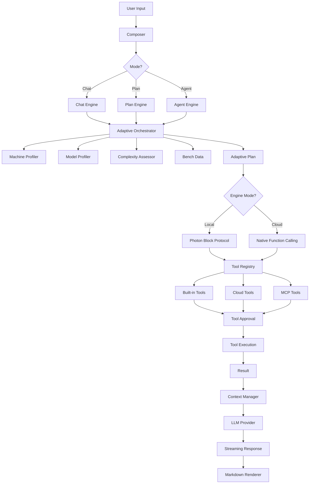

# 🌳 Photon Extension — Features Tree

> Comprehensive hierarchical view of every component, module, and feature in the Photon VS Code extension.
> Generated from full codebase audit.

---

```
Photon VS Code Extension
│
├── 📦 src/extension.ts                          # Entry point — activates webview, chat participant, commands
│
├── 🔧 src/core/                                 # Core engine — adaptive AI, tools, LLM providers
│   │
│   ├── 📊 adaptive/                             # Adaptive intelligence system
│   │   ├── autoMode.ts                          #   Auto-selects best model per request using complexity + bench + scores
│   │   ├── complexity.ts                        #   Heuristic task classifier: simple / moderate / complex
│   │   ├── machineProfiler.ts                   #   Detects RAM, CPU, GPU (nvidia-smi/rocm-smi), classifies machine tier
│   │   ├── modelProfiler.ts                     #   Profiles model params, quantization, family, context, capabilities
│   │   ├── orchestrator.ts                      #   Builds AdaptivePlan: model, context, temp, tools, rationale
│   │   └── tokens.ts                            #   Token estimation and context window budgeting
│   │
│   ├── 🤖 agent/                                # Agent execution engines
│   │   ├── engine.ts                            #   Local mode agent engine (Photon block protocol)
│   │   ├── cloudEngine.ts                       #   Cloud mode agent engine (native function calling)
│   │   ├── unifiedEngine.ts                     #   Unified engine abstraction over local/cloud
│   │   ├── contextManager.ts                    #   Context window fitting: drop oldest, keep system+tools
│   │   └── repair.ts                            #   Tool call repair: corrective prompts, max 2 retries
│   │
│   ├── 📈 bench/                                # Benchmarking system
│   │   └── bench.ts                             #   Photon Bench: throughput, latency, tool reliability, reasoning
│   │
│   ├── 🔍 index/                                # Workspace indexing (offline-first RAG)
│   │   ├── chunker.ts                           #   Splits source files into embeddable chunks
│   │   ├── vectorStore.ts                       #   Pure-TS cosine-similarity vector store
│   │   ├── embeddings.ts                        #   Local embedding via Ollama (nomic-embed-text)
│   │   └── retriever.ts                         #   Semantic search → context injection into prompts
│   │
│   ├── 🧠 intelligence/                         # Intelligence level management
│   │   ├── index.ts                             #   Level definitions: low / medium / high / max / auto
│   │   └── policy.ts                            #   Tool limits, output caps, prompt variants per level
│   │
│   ├── ⚙️ kernel/                               # Session kernel (event-sourced)
│   │   └── session/                             #   Session persistence layer
│   │
│   ├── 🔄 llm/                                  # LLM provider abstraction layer
│   │   ├── providerManager.ts                   #   Unified routing: model prefix → correct provider
│   │   ├── catalogs.ts                          #   Static model catalogs for providers without live APIs
│   │   ├── types.ts                             #   Provider interfaces and model type definitions
│   │   ├── sse.ts                               #   Server-Sent Events parser for streaming
│   │   ├── imagePath.test.ts                    #   Image path handling tests
│   │   └── providers/                           #   Provider implementations
│   │       ├── ollamaProvider.ts                 #     Native Ollama adapter (local primary)
│   │       ├── openaiCompatProvider.ts           #     OpenAI-compatible (Groq, Together, NIM, OpenRouter, etc.)
│   │       ├── geminiProvider.ts                 #     Google Gemini API with live model listing
│   │       └── anthropicProvider.ts              #     Anthropic Claude API
│   │
│   ├── 🦙 ollama/                               # Ollama-specific utilities
│   │   ├── client.ts                            #   Ollama REST client (model listing, chat, show)
│   │   └── types.ts                             #   Ollama response/request types
│   │
│   ├── 💬 prompts/                              # System prompt generation
│   │   ├── system.ts                            #   Dynamic system prompt builder (mode + intelligence + tools)
│   │   └── cloudSystem.ts                       #   Cloud-mode system prompt variant
│   │
│   ├── 📡 protocol/                             # Photon block protocol (tool calling format)
│   │   ├── parse.ts                             #   Multi-format parser: [TOOL], <tool_call>, JSON, XML
│   │   ├── format.ts                            #   Formats tool specs into photon-block instructions
│   │   ├── serialize.ts                         #   Serializes messages for the photon protocol
│   │   └── serialize.v2.ts                      #   V2 serializer with enhanced formatting
│   │
│   └── 🔩 tools/                                # Tool system (14 built-in + cloud + MCP)
│       ├── registry.ts                          #   Central tool registry with priority-based selection
│       ├── types.ts                             #   Tool spec interfaces and result types
│       ├── paths.ts                             #   Workspace path resolution utilities
│       ├── workspaceMap.ts                      #   Compact project file tree for prompt injection
│       ├── builtin/                             #   Built-in tools
│       │   ├── index.ts                         #     Tool registration and export hub
│       │   ├── files.ts                         #     read_file, edit_file, write_file, move_path, list_dir
│       │   ├── search.ts                        #     find_files, search_code, code_outline
│       │   ├── terminal.ts                      #     run_command (shell execution with approval)
│       │   ├── verify.ts                        #     get_diagnostics (VS Code editor errors/warnings)
│       │   ├── web.ts                           #     web_search (DuckDuckGo), web_fetch (URL extraction)
│       │   └── plan.ts                          #     todo_write (task checklist), think (scratchpad)
│       ├── cloud/                               #   Cloud-native tools
│       │   └── cloudTools.ts                    #     Cloud equivalents: write_to_file, replace_in_file, execute_command
│       └── mcp/                                 #   Model Context Protocol integration
│           ├── bridge.ts                        #     MCP tool bridge (registers MCP tools in Photon)
│           ├── mcpClient.ts                     #     HTTP transport for remote MCP servers
│           ├── mcpStdioClient.ts                #     Stdio transport for local MCP servers
│           └── transport.ts                     #     Transport abstraction layer
│
├── 🖥️ src/host/                                 # VS Code host layer — UI providers, stores, controllers
│   │
│   ├── ChatViewProvider.ts                      #   WebviewViewProvider: hosts the React chat UI
│   ├── PhotonController.ts                      #   Main controller: orchestrates engine, model, session
│   ├── LmProvider.ts                            #   VS Code LanguageModelChatProvider + @photon participant
│   ├── unifiedRuntime.ts                        #   Unified runtime installer (bridges host ↔ core)
│   ├── indexService.ts                          #   Workspace indexing service (file watcher, embed, persist)
│   ├── modelConfigStore.ts                      #   Per-model config persistence (globalState + .photon/config)
│   ├── projectConfig.ts                         #   .photon/config.json reader + file watcher
│   ├── projectStore.ts                          #   Project-scoped state (sessions, settings per workspace)
│   ├── sessionStore.ts                          #   Session persistence: create, load, save, prune (40 max)
│   └── benchStore.ts                            #   Benchmark results persistence (200 max, versioned)
│
├── 🧬 src/photon-core/                          # New harness: event-sourced agent architecture
│   │
│   ├── boot/
│   │   └── index.ts                             #   Wires up harness components + legacy provider bridge
│   ├── agent/
│   │   ├── agent.ts                             #   AgentRegistry: creates/manages agents with inbox queues
│   │   ├── inbox.ts                             #   Agent inbox for message queuing
│   │   └── types.ts                             #   Agent type definitions
│   ├── loop/
│   │   ├── agentLoop.ts                         #   Event-sourced agent loop (step/turn lifecycle)
│   │   ├── agentLoop.test.ts                    #   Agent loop unit tests
│   │   └── toolCallAssembler.ts                 #   Assembles partial tool calls from streaming chunks
│   ├── session/
│   │   ├── store.ts                             #   SessionRegistry: durable append-only event store
│   │   └── types.ts                             #   Session event types
│   ├── tools/
│   │   └── pipeline.ts                          #   ToolPipeline: priority + capability gating
│   ├── systemPrompt/
│   │   └── registry.ts                          #   SystemPromptRegistry: assembles prompts from templates
│   ├── intelligence/
│   │   └── plugin.ts                            #   Intelligence plugin (pre-step hooks, plan rewriting)
│   └── llm/
│       └── types.v2.ts                          #   LLM adapter bridge (legacy → harness interface)
│
├── 🤝 src/shared/                               # Shared types and protocol definitions
│   ├── protocol.ts                              #   Typed bidirectional message protocol (Host ↔ View)
│   └── types.ts                                 #   Shared TypeScript interfaces
│
├── 🎨 webview-ui/                               # React-based chat UI (VS Code webview)
│   │
│   ├── index.html                               #   HTML shell for the webview
│   ├── tsconfig.json                            #   TypeScript config for webview
│   └── src/
│       ├── main.tsx                             #   React entry point (mounts App)
│       ├── App.tsx                              #   Root component: layout, message routing, state
│       ├── vscode.ts                            #   VS Code API bridge (postMessage, getState, setState)
│       ├── attachments.ts                       #   Attachment handling (images, text files, clipboard)
│       │
│       ├── state/
│       │   ├── store.ts                         #   Global state store (messages, config, sessions)
│       │   └── store.compat.d.ts                #   Store type declarations
│       │
│       ├── theme/
│       │   └── photon.css                       #   Photon UI theme (CSS variables, dark/light)
│       │
│       └── components/                          #   UI components
│           ├── Header.tsx                       #     Top bar: model picker, mode switcher, settings gear
│           ├── Composer.tsx                      #     Message input: auto-grow textarea, attachments, send
│           ├── MessageList.tsx                   #     Scrollable message history container
│           ├── Message.tsx                       #     Single message (user/assistant/tool) renderer
│           ├── Markdown.tsx                      #     Markdown renderer with syntax-highlighted code blocks
│           ├── ToolCard.tsx                      #     Tool call visualization (name, args, status, result)
│           ├── ContextMeter.tsx                  #     Token usage bar with breakdown tooltip
│           ├── StatusIndicator.tsx                #     Idle / thinking / running / error state indicator
│           ├── CapabilityBadges.tsx               #     Model capability badges (🔧👁🧠🎵🎬)
│           ├── ModelConfigs.tsx                   #     Per-model settings editor (ctx, sampling, llama flags)
│           ├── CloudProviders.tsx                 #     Provider enable/disable, API key entry
│           ├── SettingsPanel.tsx                  #     Settings: intelligence, adaptive, auto-approve, indexing
│           ├── TransparencyPanel.tsx              #     Auto Mode rationale: why this model was chosen
│           ├── SessionHistory.tsx                 #     Sidebar session list (title, mode, model, count)
│           ├── Hero.tsx                          #     Landing/empty state hero component
│           ├── Approval.tsx                      #     Tool approval dialog (approve/deny side-effect tools)
│           ├── Icons.tsx                         #     SVG icon components
│           ├── Toggle.tsx                        #     Toggle switch component
│           ├── ErrorBanner.tsx                   #     Non-fatal error display with dismiss
│           ├── ErrorBoundary.tsx                 #     React error boundary (prevents full UI crash)
│           └── OfflineBanner.tsx                 #     Warns when Ollama is unreachable
│
├── 📄 docs/                                     # Documentation
│   ├── FEATURES.md                              #   Feature checklist (all implemented features)
│   ├── photon-blueprint.md                      #   Architecture blueprint
│   ├── photon-build-modules.md                  #   Build module documentation
│   ├── PHOTON_HARNESS_MIGRATION.md              #   Migration guide: legacy → harness engine
│   ├── product_info.md                          #   Product information
│   ├── UI_PREMIUM_IMPROVEMENTS.md               #   UI improvement roadmap
│   └── Usecase.md                               #   Use cases and scenarios
│
├── 📁 media/                                    # Extension assets (icons, images)
│
├── ⚙️ Build & Config
│   ├── package.json                             #   Extension manifest + VS Code contribution points
│   ├── tsconfig.json                            #   TypeScript configuration
│   ├── vite.config.ts                           #   Vite config (webview bundling)
│   ├── esbuild.mjs                              #   esbuild config (extension host bundling)
│   ├── pnpm-workspace.yaml                      #   Monorepo workspace config
│   └── README.md                                #   Project README with full documentation
│
└── 🧪 deepseek-harness/                         # DeepSeek harness (reference/test framework)
    └── deepseek-harness-master/                  #   Full harness codebase
        ├── apps/                                #     Application modules
        ├── packages/                            #     Shared packages
        ├── native/                              #     Native bindings
        ├── python/                              #     Python tooling
        ├── scripts/                             #     Build/utility scripts
        └── website/                             #     Documentation site
```

---

## 📋 Feature Summary by Domain

### 🎯 Adaptive Intelligence
| Feature | File | Description |
|---------|------|-------------|
| Auto Mode | `adaptive/autoMode.ts` | Selects best model per request based on complexity + benchmarks |
| Task Complexity | `adaptive/complexity.ts` | Heuristic classifier: simple / moderate / complex |
| Machine Profiling | `adaptive/machineProfiler.ts` | Detects RAM, CPU, GPU; classifies as low/mid/high |
| Model Profiling | `adaptive/modelProfiler.ts` | Detects params, quantization, capabilities, context length |
| Adaptive Plan | `adaptive/orchestrator.ts` | Builds full plan: model, context, temp, tools, rationale |
| Intelligence Levels | `intelligence/index.ts` | 5 tiers: auto, max (8192), high (4096), medium (2048), low (768) |

### 🛠️ Tool System
| Feature | File | Description |
|---------|------|-------------|
| read_file | `tools/builtin/files.ts` | Read file contents with line range support |
| edit_file | `tools/builtin/files.ts` | Surgical find-and-replace with fuzzy whitespace matching |
| write_file | `tools/builtin/files.ts` | Create or overwrite files |
| move_path | `tools/builtin/files.ts` | Rename/move files and directories |
| list_dir | `tools/builtin/files.ts` | List directory contents |
| find_files | `tools/builtin/search.ts` | Find files by glob pattern |
| search_code | `tools/builtin/search.ts` | Regex content search across workspace |
| code_outline | `tools/builtin/search.ts` | Structural overview of large files |
| run_command | `tools/builtin/terminal.ts` | Execute shell commands with approval |
| get_diagnostics | `tools/builtin/verify.ts` | Surface VS Code editor errors/warnings |
| web_search | `tools/builtin/web.ts` | DuckDuckGo search (no API key) |
| web_fetch | `tools/builtin/web.ts` | Fetch and extract readable text from URLs |
| todo_write | `tools/builtin/plan.ts` | Task checklist for multi-step plans |
| think | `tools/builtin/plan.ts` | Private reasoning scratchpad |
| Cloud tools | `tools/cloud/cloudTools.ts` | Cloud-native equivalents for cloud engine mode |
| MCP integration | `tools/mcp/*` | Model Context Protocol server lifecycle |
| Tool repair | `agent/repair.ts` | Corrective prompts for malformed tool calls (max 2 retries) |
| Tool registry | `tools/registry.ts` | Priority-based tool selection for weak models |

### 🔌 Multi-Provider Support
| Provider | File | Type |
|----------|------|------|
| Ollama | `llm/providers/ollamaProvider.ts` | Local |
| OpenAI-compatible | `llm/providers/openaiCompatProvider.ts` | Cloud (Groq, Together, NIM, OpenRouter, etc.) |
| Google Gemini | `llm/providers/geminiProvider.ts` | Cloud |
| Anthropic Claude | `llm/providers/anthropicProvider.ts` | Cloud |
| Provider routing | `llm/providerManager.ts` | Routes by model prefix to correct provider |

### 🖥️ UI Components
| Component | File | Purpose |
|-----------|------|---------|
| Header | `webview-ui/components/Header.tsx` | Model picker, mode switcher, settings |
| Composer | `webview-ui/components/Composer.tsx` | Auto-grow input, attachments, send/stop |
| MessageList | `webview-ui/components/MessageList.tsx` | Scrollable message history |
| Message | `webview-ui/components/Message.tsx` | User/assistant/tool message renderer |
| Markdown | `webview-ui/components/Markdown.tsx` | Syntax-highlighted markdown rendering |
| ToolCard | `webview-ui/components/ToolCard.tsx` | Tool call visualization |
| ContextMeter | `webview-ui/components/ContextMeter.tsx` | Token usage bar with tooltip |
| StatusIndicator | `webview-ui/components/StatusIndicator.tsx` | Idle/thinking/running/error states |
| CapabilityBadges | `webview-ui/components/CapabilityBadges.tsx` | Model capability visual badges |
| ModelConfigs | `webview-ui/components/ModelConfigs.tsx` | Per-model settings editor |
| CloudProviders | `webview-ui/components/CloudProviders.tsx` | Provider management panel |
| SettingsPanel | `webview-ui/components/SettingsPanel.tsx` | Full settings interface |
| TransparencyPanel | `webview-ui/components/TransparencyPanel.tsx` | Auto Mode decision rationale |
| SessionHistory | `webview-ui/components/SessionHistory.tsx` | Session list sidebar |
| Approval | `webview-ui/components/Approval.tsx` | Tool approval dialog |
| Hero | `webview-ui/components/Hero.tsx` | Landing/empty state |

### 🔄 Session & State Management
| Feature | File | Description |
|---------|------|-------------|
| Session store | `host/sessionStore.ts` | Create, load, save, prune sessions (40 max) |
| Project config | `host/projectConfig.ts` | `.photon/config.json` reader + file watcher |
| Model config store | `host/modelConfigStore.ts` | Per-model settings persistence |
| Bench store | `host/benchStore.ts` | Benchmark results (200 max, versioned) |
| Project store | `host/projectStore.ts` | Project-scoped state per workspace |

### 🧬 Harness (Event-Sourced Engine)
| Component | File | Description |
|-----------|------|-------------|
| Boot module | `photon-core/boot/index.ts` | Wires up all harness components |
| AgentRegistry | `photon-core/agent/agent.ts` | Creates/manages agents with inbox queues |
| AgentLoop | `photon-core/loop/agentLoop.ts` | Event-sourced loop with step/turn lifecycle |
| ToolCallAssembler | `photon-core/loop/toolCallAssembler.ts` | Assembles partial tool calls from streaming |
| SessionRegistry | `photon-core/session/store.ts` | Durable append-only event store |
| ToolPipeline | `photon-core/tools/pipeline.ts` | Priority + capability gated tool pipeline |
| PromptRegistry | `photon-core/systemPrompt/registry.ts` | Assembles system prompts from templates |
| Intelligence plugin | `photon-core/intelligence/plugin.ts` | Pre-step hooks, plan rewriting |

---

## 📊 Architecture Flow



---

*Generated from codebase audit — Photon v0.1.0*
