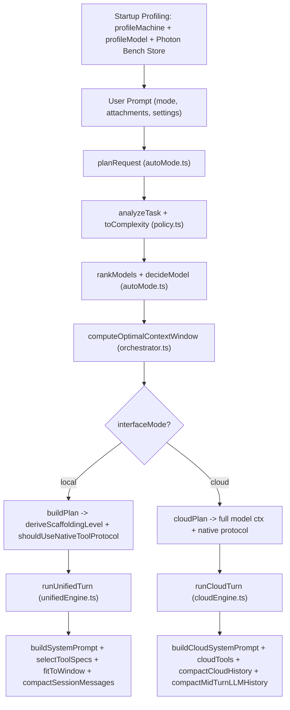

# Photon Adaptive Intelligence — Architecture & Specification

> Machine-readable & engineering reference for Photon's adaptive routing, hardware profiling, inverse scaffolding, and execution control layer.

---

## 1. Core Design Philosophy: Inverse Scaffolding

Photon's **Adaptive Intelligence** tailors execution strategy to three live runtime axes: **Hardware Capacity**, **Model Capability**, and **Task Complexity/Risk**.

Unlike systems that restrict tools on smaller models, Photon uses **Inverse Cognitive Scaffolding**:
- **Tool access stays complete** for all tiers (`LEVELS.*.maxTools = 40`; read/write availability is governed by **Mode** boundaries — `chat`, `plan`, `agent` — not model size).
- **Scaffolding scales inversely with model capability**: smaller or lower-reliability local models receive **more** behavioral structure (`max` / `high` prompts, worked tool examples, lower temperature, tolerant block parsing), while capable frontier models run with minimal overhead (`low` / `medium` or permissive `cloudPlan`).

---

## 2. End-to-End Turn Pipeline

Live orchestration entrypoints live in [`PhotonController.runPrompt`](../src/host/PhotonController.ts) (turn planning) and [`PhotonController.recomputePlan`](../src/host/PhotonController.ts) (idle config changes).

---

## 3. Subsystems & Exact Mechanics

### 3.1 Hardware Profiling (`src/core/adaptive/machineProfiler.ts`)
- **`profileMachine()`**: Reads `os.totalmem()`, `os.freemem()`, CPU count/model, OS/arch, and detects GPU VRAM (30s cache TTL):
  1. `nvidia-smi` query (preferred on all OSes).
  2. Windows fallback: reads QWORD registry key `HardwareInformation.qpMemorySize` (avoiding the 4 GB 32-bit `Win32_VideoController.AdapterRAM` saturation cap) and falls back to CIM display name; flags integrated Intel/UHD/Iris GPUs with 50% shared system RAM.
  3. macOS fallback: `system_profiler SPDisplaysDataType`; Apple Silicon unified memory estimates `floor(totalmem * 0.65)`.
  4. Linux fallback: `/sys/class/drm/card*/device/mem_info_vram_total`.
- **`classifyMachine(totalRamBytes, vramBytes)`**:
  - `high`: `vramGb >= 12 || totalRamGb >= 32`
  - `mid`: `vramGb >= 6 || totalRamGb >= 16`
  - `low`: otherwise
- **`sampleHardwareMetrics()`** (1s TTL): Live telemetry of RAM usage, GPU utilization %, VRAM used/free/total, and GPU temperature.

### 3.2 Model Profiling & Capability Matrix (`src/core/adaptive/modelProfiler.ts`, `src/core/intelligence/policy.ts`, `src/core/bench/bench.ts`)
- **Parameter parsing (`parseEffectiveParams`)**: Handles explicit effective MoE tags (`gemma4:e2b` → `2B`, `gemma4:e4b` → `4B`), `details.parameter_size`, and tag suffixes (`:3b`, `:7b`, `-14b`).
- **Model tier (`classifyModel`)**:
  - `tiny`: `paramsB <= 4.2`
  - `small`: `4.2 < paramsB <= 8.5` (or unknown)
  - `medium`: `8.5 < paramsB < 20`
  - `large`: `paramsB >= 20`
- **Modality & thinking probes (`profileModel`, 10-min TTL)**: Inspects Ollama `/api/show` (`model_info.*.context_length`, `capabilities`, `template`) with name-hint fallbacks for `toolTrained`, `vision`, `thinking`, `thinkingLevels`, `audio`, `video`.
- **Capability Profile (`capabilityForModel`)**:
  - Heuristic priors by tier: `tiny = 0.38`, `small = 0.55`, `medium = 0.72`, `large = 0.88` (adjusted for `thinking` and `toolTrained`).
  - **Photon Bench v4 override (`BENCH_VERSION = 4`)**: Fresh benchmarks (`age <= 30 days` and `methodologyVersion >= 1`) override `speed`, `toolCalling`, `schemaAdherence`, `reasoning`, `recovery`, `editFidelity`, `verification`, `contextRetention`, and `coding`.

### 3.3 Task Analysis (`analyzeTask` & `toComplexity` in `src/core/intelligence/policy.ts`)
Extracts multidimensional signals from `(prompt, mode, attachmentCount)`:
- **`scope`**: `"codebase"` | `"multi_file"` (≥2 file/@ refs or multi-file phrasing) | `"single_file"`
- **`reasoning`**: `"high"` (debug/architecture/refactor/optimize/concurrency/security/root cause) | `"medium"` (implement/fix/edit/multi-file) | `"low"`
- **`risk`**: `"destructive"` (recursive delete, `git reset --hard`, credential wipe, drop DB) | `"high"` (deploy/publish/migration/install/git push/auth changes) | `"medium"` (mutating intent) | `"low"` (read-only questions or non-imperative `chat`)
- **`verification`**: Required checks inferred from prompt (`"tests"`, `"build"`, `"lint"`, `"diagnostics"`, `"runtime"`).
- **`ambiguity`**: `"medium"` when vague pronouns appear with `0` file references, else `"low"`.
- **`estimatedSteps`**: `clamp(1, 20, 1 + refs + scopeOffset + verification.length)`.
- **`toComplexity` (`classifyComplexity`)**:
  - `"complex"` (`minContextTokens = 12,288`): `scope === "codebase" || reasoning === "high" || promptTokens > 1200`
  - `"moderate"` (`minContextTokens = 6,144`): `scope === "multi_file" || reasoning === "medium" || promptTokens > 350`
  - `"simple"` (`minContextTokens = 2,048`)
- **`isFreshInfoRequest`**: Detects live/real-time queries (weather, prices, news, releases, explicit web search) to promote `web_search`/`web_fetch`.

### 3.4 Multi-Signal Auto Routing (`src/core/adaptive/autoMode.ts`)
- **Disabled / Pinned modes**:
  - `adaptiveEnabled === false`: keeps `previousModel` (or pinned/first) untouched; still computes scores/fallbacks.
  - `pinnedModel` set: honors user choice directly (`auto: false, pinned: true`).
- **Scoring (`rankModels`)** when Auto Mode is enabled (`autoSelect = true`):
  - `contextFit` (`+30` if `model.contextLength >= minContextTokens`, `-22.5` penalty if tight) + `contextHeadroom` (up to `+6`)
  - Capability & ideal-target fit: `toolCalling` (`×18`), `coding` (`×14`), `recovery` (`×10`), `verification` (`×8`), proximity to `idealReasoning` (`×12`), proximity to `idealTool` (`×8`)
  - `throughput`: normalized `bench.tokensPerSec` (`×12`)
  - Hardware fit (`classifyHardwareFit`):
    - `gpu`: `weightGb + 1.0 <= vramGb`
    - `hybrid`: spills across `vramGb + 0.775 * totalRamGb`
    - `cpu` / `cloud` / `tight` (`-8` penalty if tight)
  - Cost & privacy:
    - `localPreference` (`+3`), `-15` penalty on expensive cloud models (`>$10/1M`) for `"simple"` tasks.
    - `localOnly` privacy mode applies `-200` to cloud models.
- **Controlled fallback (`selectFallbackModel`)**: Ranks surviving `fits` candidates and **refuses silent escalation** from local to paid cloud models unless `allowCloudEscalation === true`.

### 3.5 Hardware-Aware Context Window Calculator (`computeOptimalContextWindow` in `src/core/adaptive/orchestrator.ts`)
- Runs when `adaptiveEnabled === true` and `machine !== null` on **local** models (cloud models use their full advertised `contextLength`):
  1. **Model weights (`weightGb`)**: Uses `model.sizeBytes` if known, else `paramsB * 0.65 GB`.
  2. **KV cache cost per 1k tokens**: `clamp(paramsB * 0.022, 0.04, 0.40) GB`.
  3. **Memory safety pool**:
     - `usableVramGb = max(0, vramGb - 0.5)`
     - `ramSafetyBufferGb = totalRamGb * 0.225` (**22.5% OS/VS Code safety reserve**)
     - `usableSystemRamGb = max(0.5, min(freeRamGb - 0.10 * totalRamGb, totalRamGb - ramSafetyBufferGb))`
     - `rawSafeTokens = floor(((usableVramGb + usableSystemRamGb - weightGb) / kvGbPer1k) * 1024)`
  4. **Hybrid CPU spill cap**: If `weightGb + 8 * kvGbPer1k > usableVramGb`:
     - `cpuCores >= 12` → cap `65,536`; `>= 8` → `32,768`; `< 8` → `16,384` (else `131,072` when 100% GPU-resident).
  5. **Bucket snap**: `targetTokens = clamp(min(8192, modelMax), modelMax, min(rawSafeTokens, cpuPracticalCap))`, snapped to highest bucket `<= targetTokens` in `[8192, 16384, 32768, 65536, 131072, 262144]`.
  6. Explicit per-model or user `userNumCtx` overrides this while remaining clamped to `modelMax`.

### 3.6 Plan Assembly (`buildPlan` vs `cloudPlan`)

| Parameter | Local Adaptive (`buildPlan`) | Cloud (`cloudPlan`) |
| :--- | :--- | :--- |
| Context Window | Hardware-computed `numCtx` (or pinned `userNumCtx`) | Full model `contextLength` (default `128_000`) |
| Scaffolding Level | Derived (`max` / `high` / `medium` / `low`) unless pinned | Fixed `"max"` profile metadata; direct [`buildCloudSystemPrompt`](../src/core/prompts/cloudSystem.ts) |
| Tool Protocol | [`shouldUseNativeToolProtocol`](../src/core/intelligence/policy.ts#L175) → `"native"` or `"photon-block"` | Always `"native"` |
| Temperatures (`chat` / `task`) | `max`: `0.15/0.1`, `high`: `0.2/0.1`, `medium`/`low`: `0.25/0.15` | `0.3` |
| Step Ceilings (`MODE_CAPS`) | `chat: 100`, `plan: 150`, `agent: 200` | `chat: 100`, `plan: 150`, `agent: 200` |

**`deriveScaffoldingLevel(tier, capabilities, task)`**:
- `tiny` or `small` (`rank <= 1`), OR `toolCalling < 0.72 || schemaAdherence < 0.72` → **`"max"`**
- `medium` (`rank === 2`) → **`"max"`** on complex/high-risk/codebase tasks, else **`"high"`**
- `large` (`rank === 3`) → **`"high"`** (complex/codebase/destructive), **`"medium"`** (moderate/multi-file), else **`"low"`**

**`shouldUseNativeToolProtocol(model, capabilities, bench, intelligence)`**:
- Cloud model → always `true` (`"native"`).
- Local model → `true` ONLY if model metadata reports native `"tools"` capability, **or** (`intelligence !== "low"` AND fresh bench has `toolCallReliability >= 0.80 && schemaAdherence >= 0.82 && toolCalling >= 0.82`). Otherwise stays on tolerant `"photon-block"`.

### 3.7 Runtime Adaptation (`system.ts`, `policy.ts`, `contextManager.ts`, `compactor.ts`)
- **Prompt & RAG Budgeting (`buildSystemPrompt`)**: Allocates a `numCtx` fraction by scaffolding tier (`low: 20% / 30 map lines`, `medium: 26% / 60`, `high: 34% / 90`, `max: 42% / 120`) for identity, mode rules, tool instructions, project context digest, workspace map, and retrieved RAG chunks.
- **Phase-Aware Tool Ordering (`selectToolSpecs`, `rankTools`)**: Enforces mode boundaries (`chat` = read/web only, no MCP; `plan` = read/web only; `agent` = full + MCP) and re-ranks tools per phase (`orient` boosts read/search/web; `edit` boosts write; `verify` boosts `get_diagnostics`/`run_command`; `freshInfo` places `web_search`/`web_fetch` first).
- **Execution Guardrails (`buildExecutionPolicy`)**: Computes concurrency (`1–4` raw policy, serialized `1` in `buildPlan` / destructive risk), generation/reasoning token budgets, approval requirement (`high`/`destructive`), and blocks terminal commands on `"destructive"` tasks.
- **Adaptive Context Fit & Compaction (`fitToWindow`, `compactor.ts`)**:
  - Reserves output tokens, clamps oversized tool payloads without breaking JSON/line boundaries (`clampStructuredToolResult`), and preserves task anchor + latest active tool pairs (`sanitizeToolPairing`).
  - Pre-turn auto-compaction triggers at `>= 75%` of usable input window (accounting for `incomingTokens`, `fixedOverheadTokens`, and `reserveOutputTokens`), plus mid-turn compaction & reactive context-overflow recovery inside both `runCloudTurn` and `runUnifiedTurn`.

---

## 4. Module Index (For AI / Code Navigation)

| File | Responsibility |
| :--- | :--- |
| [`src/core/adaptive/machineProfiler.ts`](../src/core/adaptive/machineProfiler.ts) | OS RAM, CPU core, cross-platform GPU VRAM detection & live metrics sampling |
| [`src/core/adaptive/modelProfiler.ts`](../src/core/adaptive/modelProfiler.ts) | Ollama `/api/show` probing, MoE effective param parsing, model tiering & capabilities |
| [`src/core/adaptive/modelAdvisor.ts`](../src/core/adaptive/modelAdvisor.ts) | Curated `MODEL_CATALOG` hardware recommendations & fit evaluation |
| [`src/core/adaptive/complexity.ts`](../src/core/adaptive/complexity.ts) | Prompt complexity wrapper (`classifyComplexity`) |
| [`src/core/intelligence/policy.ts`](../src/core/intelligence/policy.ts) | Task/risk analysis, capability mapping, tool ranking, protocol & execution policy |
| [`src/core/adaptive/orchestrator.ts`](../src/core/adaptive/orchestrator.ts) | `buildPlan`, `deriveScaffoldingLevel`, `computeOptimalContextWindow` |
| [`src/core/adaptive/autoMode.ts`](../src/core/adaptive/autoMode.ts) | Multi-signal `rankModels`, `decideModel`, `selectFallbackModel`, `planRequest` |
| [`src/core/adaptive/tokens.ts`](../src/core/adaptive/tokens.ts) | Pluggable `registerTokenizer` + code-density-aware `estimateTokens` |
| [`src/core/bench/bench.ts`](../src/core/bench/bench.ts) | Photon Bench v4 capability measurement & routing baseline evaluation |
| [`src/core/prompts/system.ts`](../src/core/prompts/system.ts) | Scaffolding-budgeted local prompt assembly (`buildSystemPrompt`) |
| [`src/core/agent/contextManager.ts`](../src/core/agent/contextManager.ts) | Budget-enforcing window fitter & structured output clamping (`fitToWindow`) |
| [`src/core/agent/compactor.ts`](../src/core/agent/compactor.ts) | Hybrid provider + deterministic fact-preserving compaction & mid-turn compaction |
| [`src/host/PhotonController.ts`](../src/host/PhotonController.ts) | Extension-host orchestration (`runPrompt`, `cloudPlan`, `recomputePlan`, auto-compact) |

