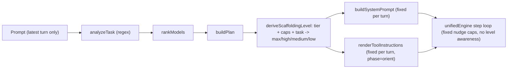

# Adaptive Scaffolding & Adaptive Engine — Improvement Plan (v3)

> Scope: `src/core/adaptive/*`, `src/core/intelligence/policy.ts`, `src/core/prompts/system.ts`, `src/core/protocol/serialize.ts`, `src/core/agent/unifiedEngine.ts`, `src/core/bench/bench.ts`, `PhotonController.runPrompt`.
> Builds on [adaptive_plan_part_a.md](file:///b:/Coding/Projects/Photon/Photon/docs/adaptive_plan_part_a.md) (v2 audit, IDs like `L-1`, `R-1` refer to it). Checked against HEAD `0a61615`.

---

## 0. Summary

**Implementation progress:** Phases **0**, **1**, **2**, **3**, and **4** are complete and verified (`✅`).

| v2 ID | Finding | Status | Evidence |
|---|---|---|---|
| L-1 | Tool surface picked once per turn with phase hard-coded to `"orient"` | ✅ Fixed (Phase 2) | `inferStepPhase` + per-phase rebuild in [unifiedEngine.ts](file:///b:/Coding/Projects/Photon/Photon/src/core/agent/unifiedEngine.ts) |
| L-2 | Scaffolding = one enum picked by tier; tiny/small → always `max` | ✅ Fixed (Phase 2) | `ScaffoldProfile` + `deriveScaffoldProfile` in [orchestrator.ts](file:///b:/Coding/Projects/Photon/Photon/src/core/adaptive/orchestrator.ts) |
| L-3 | Core prompt never trimmed; only extras are budgeted | ✅ Fixed (Phase 2) | Priority-trimmed `workflow` / `result_framing` + clamped budget in [system.ts](file:///b:/Coding/Projects/Photon/Photon/src/core/prompts/system.ts) |
| L-6 | Native protocol gated by block-format bench / `"tools"` capability | ✅ Fixed (Phase 4) | Separate 5-sample `nativeToolCallReliability` probe in [bench.ts](file:///b:/Coding/Projects/Photon/Photon/src/core/bench/bench.ts) & gating in [policy.ts](file:///b:/Coding/Projects/Photon/Photon/src/core/intelligence/policy.ts) |
| L-8 | Live failure signals never feed back | ✅ Fixed (Phase 3) | Rungs `1–4` + hysteresis in [governor.ts](file:///b:/Coding/Projects/Photon/Photon/src/core/adaptive/governor.ts) & [unifiedEngine.ts](file:///b:/Coding/Projects/Photon/Photon/src/core/agent/unifiedEngine.ts) |
| T-1 | File-ref regex over-matches (`e.g`, `v1.2`, `node.js`) | ✅ Fixed (Phase 1) | `extractFileReferences` in [policy.ts:21](file:///b:/Coding/Projects/Photon/Photon/src/core/intelligence/policy.ts#L21) |
| R-1/2/3 | No vision constraint; advertised ctx not achievable ctx; `tight` only −8 | ✅ Fixed (Phase 1) | `rankModels` in [autoMode.ts](file:///b:/Coding/Projects/Photon/Photon/src/core/adaptive/autoMode.ts) |
| L-11 | No constrained decoding | ⬜ Open (Phase 4 / Backlog) | no `format`/`grammar` in `src/core/llm` |
| L-12 | Single turn temp; tiny thinking enabled by default | ✅ Fixed (Phase 2) | Split `toolTurnTemp`/`answerTurnTemp` & `thinking` policy in [orchestrator.ts](file:///b:/Coding/Projects/Photon/Photon/src/core/adaptive/orchestrator.ts) |

The review also turned up **new problems the v2 plan missed**. Several of them make the scaffolding work *against* small models (§2).

**Goal of v3:** turn scaffolding from a *static label chosen once per turn* into a **scaffold that is correct, fits its budget, knows the phase, and corrects itself** — and prove each piece helps, using an eval harness.

---

## 1. How it works today (the pieces that matter)



What the level actually controls today: prompt wording ("guided" vs "standard"), prompt budget share (20–42%), workspace-map lines, number of worked examples (3–5), temperature and output cap. It does **not** control the nudge/retry policy, compaction, host-side verification, the protocol after a failure, or anything that happens mid-turn.

---

## 2. New findings (not covered in v2)

| ID | Sev | Status | Finding | Evidence |
|---|---|---|---|---|
| **S-1** | **H** | ✅ Fixed (Phase 1) | **The scaffold contradicts the tool schema.** `max`/`high` prompts previously mixed `find`/`replace` with `old_str`/`new_str`. Now derived directly from `ToolSpec`. | [rulebook.ts](file:///b:/Coding/Projects/Photon/Photon/src/core/prompts/rulebook.ts) & [files.ts:503-517](file:///b:/Coding/Projects/Photon/Photon/src/core/tools/builtin/files.ts#L503-L517) |
| **S-2** | **H** | ✅ Fixed (Phase 2) | **Worked examples didn't show the tool that fails most.** Phase-aware surface (`edit` promotes `edit_file`/`append_file`) + `phase+failing` examples fix this. | [serialize.ts](file:///b:/Coding/Projects/Photon/Photon/src/core/protocol/serialize.ts), [policy.ts](file:///b:/Coding/Projects/Photon/Photon/src/core/intelligence/policy.ts) |
| **S-3** | **M** | ✅ Fixed (Phase 1) | **Duplicate rules across sections.** Deduplicated via `CORE_PROMPT_RULES` & `dedupeKey`, cutting non-tool core tokens by 31.2%. | [rulebook.ts](file:///b:/Coding/Projects/Photon/Photon/src/core/prompts/rulebook.ts), [system.ts](file:///b:/Coding/Projects/Photon/Photon/src/core/prompts/system.ts) |
| **S-4** | **H** | ✅ Fixed (Phase 1) | **Task profile was stateless across turns.** Session carry-forward (`SessionTaskContext`) + Plan→Agent inheritance implemented. | [policy.ts:128-146](file:///b:/Coding/Projects/Photon/Photon/src/core/intelligence/policy.ts#L128-L146) |
| **S-5** | **M** | ✅ Fixed (Phase 1) | **Routing ignored model switch cost.** Switch hysteresis (`+6` local / `+4` cloud continuity bonus) implemented in `rankModels`. | [autoMode.ts](file:///b:/Coding/Projects/Photon/Photon/src/core/adaptive/autoMode.ts) |
| **S-6** | **M** | ✅ Fixed (Phase 3) | **Capability numbers were fixed jumps.** `PassportStore` (EWMA, capped `5`/turn) + shrinkage blend (`K=100`) ensures one bad turn shifts caps `< 0.05`. | [passport.ts](file:///b:/Coding/Projects/Photon/Photon/src/core/adaptive/passport.ts), [policy.ts](file:///b:/Coding/Projects/Photon/Photon/src/core/intelligence/policy.ts) |
| **S-7** | **M** | ✅ Fixed (Phase 3) | **The level was fixed for the whole turn.** Governor rungs `1–4`, hysteresis relax, `native → photon-block` downgrade, and host verify/revert are live in `unifiedEngine`. | [unifiedEngine.ts](file:///b:/Coding/Projects/Photon/Photon/src/core/agent/unifiedEngine.ts), [governor.ts](file:///b:/Coding/Projects/Photon/Photon/src/core/adaptive/governor.ts) |
| **S-8** | **M** | ✅ Fixed (Phase 2) | **Prompt budget ignored absolute window size.** Clamped `{ frac, minTokens, maxTokens }` + extras floor keep 8k digest/map intact and bound 64k+ budgets. | [system.ts](file:///b:/Coding/Projects/Photon/Photon/src/core/prompts/system.ts), [orchestrator.ts](file:///b:/Coding/Projects/Photon/Photon/src/core/adaptive/orchestrator.ts) |
| **S-9** | **L** | ✅ Fixed (Phase 1) | **Dead/misleading code (`?1:1`, unused concurrency, cloud `intelligence: "max"`, `numCtx-1000`).** Cleaned up across orchestrator, engine, and controller. | [orchestrator.ts](file:///b:/Coding/Projects/Photon/Photon/src/core/adaptive/orchestrator.ts), [PhotonController.ts:2315](file:///b:/Coding/Projects/Photon/Photon/src/host/PhotonController.ts#L2315) |
| **S-10** | **M** | ✅ Fixed (Phase 0) | **No visibility into the scaffold.** Per-section `PromptTokenReport` + Transparency panel + `ContextMeter` breakdown shipped. | [system.ts](file:///b:/Coding/Projects/Photon/Photon/src/core/prompts/system.ts), [TransparencyPanel.tsx](file:///b:/Coding/Projects/Photon/Photon/webview-ui/src/components/TransparencyPanel.tsx) |
| **S-11** | **H** | ✅ Fixed (Phase 0) | **Broken `find_files` alias (`pattern` → `query`).** Caught by Phase 0 eval harness & fixed in `PARAM_ALIASES.find_files`. | [parse.ts:261](file:///b:/Coding/Projects/Photon/Photon/src/core/protocol/parse.ts#L261) |

---

## 3. Target design

### 3.1 Scaffold Profile (replaces the single enum internally)

Keep `low | medium | high | max` as **UI presets** for back-compat. Internally, derive a vector so the task and live reliability can move individual dimensions:

```ts
// src/shared/types.ts
export interface ScaffoldProfile {
  preset: IntelligenceLevel;                 // for UI + back-compat
  ruleVerbosity: "terse" | "standard" | "guided";
  toolCards: "names_only" | "shortlist" | "full";
  shortlistSize: number;                     // 4–8 full cards; rest = names + 1-line purpose
  examples: "none" | "phase" | "phase+failing"; // examples follow phase, + any tool that just failed
  stateCard: "off" | "compact" | "rich";     // goal / plan / known / next recap at end of context
  hostVerify: "off" | "diagnostics" | "diagnostics+tests";
  hostOrient: boolean;
  promptBudget: { frac: number; minTokens: number; maxTokens: number };
  sampling: { toolTurnTemp: number; answerTurnTemp: number };
  thinking: "off" | "low" | "medium" | "high";
  nudgePolicy: { continue: number; finalAnswer: number; truncation: number };
}
```

`deriveScaffoldProfile(tier, capabilities, task, numCtx, liveStats?)` replaces `deriveScaffoldingLevel`. Rules:

- **Start from the preset** chosen exactly as today. This keeps current behaviour when every new dimension is set to "today's equivalent", so it can ship safely behind a flag.
- **Task moves dimensions, not the whole preset.** For tiny/small models: a read-only `low`-reasoning question → `toolCards: shortlist`, `stateCard: off`, `hostOrient: false`. A multi-file edit → `stateCard: rich`, `hostVerify: diagnostics`.
- **Budget = clamp(frac × numCtx, minTokens, maxTokens)** (fixes S-8). Starting values: `max {0.42, 2500, 6000}`, `low {0.20, 800, 3000}`. Tune them with the eval harness.

### 3.2 Correct, single-source scaffold content (fixes S-1, S-3, L-3)

- **Rulebook module** `src/core/prompts/rulebook.ts`: each rule has an `id`, `text(level, mode)`, `priority`, `appliesTo` (modes/protocol), and a `dedupeKey`. `buildSystemPrompt` keeps one rule per `dedupeKey`.
- **Generate argument names from `ToolSpec`.** Any prose that mentions tool arguments, such as the read → edit workflow, gets them from the registry (e.g. `${argNames("edit_file")}`). Add a unit test that fails if a prompt mentions an argument name that isn't in the spec.
- **Return a structured result**: `{ text, sections: {id, tokens, kept|trimmed|dropped}[] }`. When over budget, trim by priority, including core sections (examples → workflow → framing → formatting), but never drop the identity, mode boundary or the tool-call format.
- **Language-integrity paragraph**: only include it for model families that need it (e.g. qwen/deepseek), or replace it with an output post-filter (v2 L-3b).

### 3.3 Per-step, phase-aware tool surface (fixes L-1, S-2)

- Infer the phase each step from the last tool result: nothing read yet → `orient`; a target file read in agent mode → `edit`; a successful mutation → `verify`; verification passed or nothing left to do → `final`.
- Re-run `selectToolSpecs(allSpecs, plan, phase)` **only when the phase changes**. This keeps the prompt stable within a phase, which matters for Ollama KV reuse.
- `toolCards: shortlist`: render full cards for the top-K tools of the phase, plus **one-line names for every other tool**. The parser still accepts every registered tool, so the "never withhold tools" rule holds.
- **Examples follow the phase.** In the `edit` phase the `edit_file`/`append_file` examples are always included. After a malformed call to tool X, the next step includes X's worked example (`examples: "phase+failing"`).

### 3.4 Session-aware task profile (fixes S-4, T-1, T-3)

- `analyzeTask(prompt, mode, attachments, session?)` gets a `SessionTaskContext`: the previous turn's `TaskAnalysis`, open todos, files touched this session, and recent failures.
- **Carry-forward rule:** if the prompt is a short confirmation or continuation (≤ 12 words, matching `yes|go ahead|do it|continue|proceed|implement (the|this) plan|looks good`), or open todos exist, then `task = max(current, previous)` per dimension (scope, reasoning, risk, verification).
- **Mode switch Plan → Agent** inherits the plan's scope/verification.
- **File-ref regex**: require a path separator, a leading `@`, or an extension from a known list. Strip `e.g.`, `i.e.`, version strings (`v1.2`, `1.2.3`) and known names like `node.js`/`vue.js` unless they're quoted or path-like.
- Add `needsVision` (image attachments) and `readOnly` to `TaskAnalysis`. The router will use them.

### 3.5 Reliability Governor (fixes L-8, S-7) — the core addition

**In-turn controller** (new `src/core/adaptive/governor.ts`, used by `unifiedEngine`):

```ts
type GovernorEvent = "parse_fail" | "repair" | "narration" | "duplicate" | "truncation"
  | "empty" | "invalid_args" | "diag_regression" | "tool_ok" | "verify_ok";
class Governor {
  record(e: GovernorEvent, tool?: string): GovernorAction[]; // returns escalations/de-escalations
  rung(): number; // 0..4
}
```

| Rung | What gets added | Trigger up | Trigger down |
|---|---|---|---|
| 0 | Profile as derived | — | — |
| 1 | Failing-tool example + recovery card | 1 `parse_fail`/`invalid_args` | 3 clean tool calls |
| 2 | State card (goal / plan / known / next) + tool-turn temp −0.05 | 2 failures in 4 steps | 4 clean steps |
| 3 | Protocol downgrade native → photon-block (local only) | 2 native parse failures | never within turn |
| 4 | Host takes over the step (host-run diagnostics / orientation), then force a text conclusion | 3+ failures or `diag_regression` | — |

- Rebuild the system prompt / tool block **only when the rung changes** (rare), so the hoisting optimisation stays.
- The existing nudge counters (`MAX_CONTINUE_NUDGES`, etc.) become `profile.nudgePolicy` and feed `Governor.record`.
- Every rung change is shown in the turn ("Added edit example after malformed `edit_file` call"), and there's a setting to freeze adaptivity.

**Cross-turn memory (Capability Passport, light version):** store an EWMA per `(model, quantization, runtime)` of tool-valid rate, repair rate, narration rate and native-OK/block-OK in a local store next to `benchStore`. `capabilityForModel` then blends `prior → bench → live`, weighted by evidence count (shrinkage), so one bad turn doesn't condemn a model (fixes S-6). The next session starts at the right rung.

### 3.6 Router fixes (R-1..R-3, S-5)

1. **Hard constraints first:** `needsVision && !model.vision` → exclude; `localOnly && cloud` → exclude; `hwFit === "tight"` → exclude unless nothing else fits.
2. **Achievable context:** compute `fits` with `computeOptimalContextWindow(model, machine).numCtx` (or the per-model override) instead of the advertised `contextLength`.
3. **Switch hysteresis:** add `+continuityBonus` (e.g. 6 points local, 4 cloud) to `previousModel` in the middle of a conversation. Don't switch unless the challenger wins by more than that margin. Report it in the reasons.
4. **Native-protocol gate:** require a *native* probe result (Bench) or `"tools"` capability **plus** a passport native-OK rate ≥ threshold. The governor's rung 3 is the safety net.

### 3.7 Sampling & thinking policy

- Split temperature per step type. Tool-call steps (orient/edit/verify): `toolTurnTemp` (≈ 0.05–0.1). Final answer: `answerTurnTemp` (≈ 0.2–0.3). The phase from §3.3 decides which applies.
- Thinking: `off` for tiny models unless `reasoning === "high"`; budget from `buildExecutionPolicy.generationBudgetTokens`.
- The user's per-model sampling overrides still win.

### 3.8 Cleanups (S-9)

- Remove the `?1:1` ternary and the unused concurrency. Either honour `buildExecutionPolicy.maxConcurrent` for parallel *reads* or delete it.
- Make `LEVELS` hold only fields that actually differ between levels; move `maxTools` into a constant.
- Engine budget: `budgetTokens = numCtx − plan.maxOutputTokens`.
- Cloud plan: label `intelligence` as `"cloud"` (or omit it) so the UI doesn't show "Maximum scaffolding" for cloud models.

---

## 4. Roadmap

Effort: **S** ≤ 2 days · **M** ≈ 1 week · **L** ≥ 2 weeks.

### Phase 0 — Measure first (S–M, ~1 week) — ✅ Complete
| Status | # | Task | Files | Done when |
|---|---|---|---|---|
| [x] | 0.1 | `buildSystemPrompt` returns per-section token report; log + Transparency panel | `system.ts`, `serialize.ts`, `unifiedEngine.ts`, `ContextMeter.tsx` | Breakdown visible per turn |
| [x] | 0.2 | Governor event counters only (no actions yet) | new `governor.ts`, `unifiedEngine.ts` | Events logged with model/protocol/rung/task |
| [x] | 0.3 | Prompt snapshot tests per level × mode × protocol (token count + which examples were rendered) | `test/unit/prompts.test.ts` | S-2 confirmed or refuted; budgets locked |
| [x] | 0.4 | Baseline eval: 10–15 small repo tasks × 2–3 local models (≈3B, 7–8B, 14B) | new `test/eval/` | Committed baseline table (`BASELINE_PHASE0.md`) |

### Phase 1 — Correctness quick wins (S each, ~1 week) — ✅ Complete
| Status | # | Task | Fixes | Acceptance |
|---|---|---|---|---|
| [x] | 1.1 | Fix `find/replace` → spec-derived arg names; add test that scaffold arg names ⊆ spec | S-1 | Test green; no contradicting arg names in any preset |
| [x] | 1.2 | Dedupe rules via rulebook keys | S-3 | `max` agent prompt tokens ↓ (31.2% non-tool core reduction) |
| [x] | 1.3 | Session carry-forward task profile + Plan→Agent inheritance | S-4 | "yes, go ahead" after a multi-file plan keeps scope/level; unit tests |
| [x] | 1.4 | File-ref regex fix | T-1 | False-positive table test (`e.g`, `v1.2`, `node.js`) |
| [x] | 1.5 | Router: vision hard constraint, achievable ctx, exclude `tight`, switch hysteresis | R-1..3, S-5 | Image prompt never picks text-only model; no flip on near-ties |
| [x] | 1.6 | Cleanups | S-9 | No behaviour change in existing tests |

### Phase 2 — Scaffold Profile & phase-aware surface (M–L, 2–3 weeks) — ✅ Complete
| Status | # | Task | Fixes | Acceptance |
|---|---|---|---|---|
| [x] | 2.1 | `ScaffoldProfile` + `deriveScaffoldProfile`, presets map 1:1 to today (flagged) | L-2 | Flag-off = byte-identical prompts (`scaffoldOptimizations: false`) |
| [x] | 2.2 | Budget clamp `{frac,min,max}` + priority trimming of core sections | S-8, L-3 | 8k window: digest/map no longer squeezed to zero; 64k clamped |
| [x] | 2.3 | Per-step phase inference + shortlist cards + phase examples | L-1, S-2 | Tool-card tokens ↓ 54.0% (`2,723` → `1,252` tok); all tools callable |
| [x] | 2.4 | Split sampling + thinking policy | L-12 | `toolTurnTemp` / `answerTurnTemp` split + `tiny` thinking `"off"`; user override honored |
| [x] | 2.5 | State card (reuse compactor facts) for `stateCard ≠ off` | v2 5.2.5 | Transient `<working_memory>` card active on multi-step tiny/small/medium turns |

### Phase 3 — Reliability Governor (M–L, 2–3 weeks) — ✅ Complete
| Status | # | Task | Acceptance |
|---|---|---|---|
| [x] | 3.1 | Governor actions: rungs 1–4 with hysteresis; rebuild prompt only on rung change | Rungs 1–4 (`failing_example`, `state_card` + `-0.05` temp, `protocol_downgrade`, `host_takeover`) & clean-step relax |
| [x] | 3.2 | Native → block runtime downgrade | Mid-turn Rung 3 switch clears `nativeTools`, emits `PRIMARY FORMAT`, and completes in `photon-block` |
| [x] | 3.3 | Host verify after mutation + checkpoint restore on diagnostics regression | Post-edit host `get_diagnostics`, `N→M` feedback, and automatic pre-edit file restore on regression |
| [x] | 3.4 | Passport store (EWMA) + `capabilityForModel` shrinkage blend | On-device [passport.ts](file:///b:/Coding/Projects/Photon/Photon/src/core/adaptive/passport.ts) & [passportStore.ts](file:///b:/Coding/Projects/Photon/Photon/src/host/passportStore.ts); `< 0.05` shift per bad turn; learns `initialRung` |
| [x] | 3.5 | UI: governor timeline + "freeze adaptivity" toggle | Attributable timeline & `Freeze adaptivity` switches in [TransparencyPanel.tsx](file:///b:/Coding/Projects/Photon/Photon/webview-ui/src/components/TransparencyPanel.tsx) & [SettingsPanel.tsx](file:///b:/Coding/Projects/Photon/Photon/webview-ui/src/components/SettingsPanel.tsx) |

### Phase 4 — Prove it (M, ongoing) — ✅ Complete
- [x] Bench v5 essentials: multi-sample (5 per skill), run under the **real** prompt (`buildSystemPrompt`), separate native vs block probes ([bench.ts](file:///b:/Coding/Projects/Photon/Photon/src/core/bench/bench.ts), [policy.ts](file:///b:/Coding/Projects/Photon/Photon/src/core/intelligence/policy.ts)).
- [x] Ablation runs: each `ScaffoldProfile` dimension on/off across tiers (`npm run eval:ablation`, [ablation.ts](file:///b:/Coding/Projects/Photon/Photon/test/eval/ablation.ts), [ABLATION_PHASE4.md](file:///b:/Coding/Projects/Photon/Photon/test/eval/ABLATION_PHASE4.md)).
- [x] Release gate: no tier regresses by more than 2 points and zero compliant governor issues (`npm run eval:gate`, [releaseGate.ts](file:///b:/Coding/Projects/Photon/Photon/test/eval/releaseGate.ts)).

---

## 5. Success metrics

| Metric | Source | Target (to validate after Phase 0) |
|---|---|---|
| Task success, tiny/small tiers | Eval suite | Double-digit point gain over baseline |
| Malformed/repaired calls per 100 tool calls | Governor events | −50–60% |
| System-prompt tokens at `max`, 8k window | Section report | −20–35% with same rule coverage |
| Mid-conversation model flips | Routing log | ↓ to near zero on near-ties |
| Turns where level dropped on a follow-up | Task log | 0 for confirmation follow-ups |
| User overrides of the adaptive setup | Local settings telemetry | ↓ over time |

---

## 6. Risks & open questions

- **More scaffolding can hurt some models.** Every dimension must be independently switchable and checked by ablation before it becomes a default.
- **Prompt rebuilds vs KV reuse.** Phase/rung changes rebuild the prefix. Keep changes rare (only on transitions) and put volatile content (state card, nudges) at the end.
- **The carry-forward heuristic can over-escalate** a genuinely new, simple question. Limit it to short confirmations, open todos or a mode switch, and log it.
- **Passport privacy.** Store it on-device only. Any shared priors must be opt-in.
- **Target engine (resolved):** `src/core/agent/unifiedEngine.ts` (and `src/core/agent/cloudEngine.ts` for cloud) is the canonical execution target for the Reliability Governor; `src/photon-core/loop/agentLoop.ts` is a thin compatibility shell.

---

## 7. Implementation Progress Log

| Phase | Avg `max` Agent Prompt Tok | `tools` Section Tok | Eval Result | Highlights |
|---|---:|---:|---|---|
| **Phase 0** (`BASELINE_PHASE0.md`) | 3,817 | 2,737 | 36/36 (0 issues) | Section token report, observation-only governor, cloud cache hit-rate, fixed `find_files` alias (`S-11`) |
| **Phase 1** (`EVAL_PHASE1.md`) | 3,499 | 2,723 | 36/36 (0 issues) | Spec-derived args (`S-1`), rulebook dedup (`-31.2%` non-tool core, `S-3`), session carry-forward (`S-4`), `T-1`, router `R-1..3`/`S-5`, cleanups (`S-9`) |
| **Phase 2** (`EVAL_PHASE2.md`) | **2,028** (`-46.9%` vs P0) | **1,252** (`-54.0%` vs P1) | 36/36 (0 issues) | `ScaffoldProfile`, clamped budgets + core priority trim, `inferStepPhase` + shortlist surface, split sampling + tiny thinking policy, `<working_memory>` state card |
| **Phase 3** (`EVAL_PHASE3.md`) | **2,028** (`-46.9%` vs P0) | **1,252** (`-54.0%` vs P1) | 36/36 (0 issues) | Live Governor rungs `1–4` + hysteresis, mid-turn `native → photon-block` downgrade, host verify + auto-revert on `diag_regression`, `PassportStore` EWMA shrinkage, UI timeline & freeze toggle |
| **Phase 4** (`EVAL_PHASE4.md`) | **2,028** (`-46.9%` vs P0) | **1,252** (`-54.0%` vs P1) | 36/36 + Gate PASS | Bench v5 5-sample real-prompt & separate native/block probes (`L-6`), 6-variant `ScaffoldProfile` ablation matrix (`ABLATION_PHASE4.md`), CI release gate (`eval:gate`) |
